### 👋 Hello, I'm Andrew

**💻 Backend Developer (Node.js / TypeScript)** with 1 year of commercial experience building medical software (PHP, MySQL, JavaScript). 
I build backend services end to end: API design, databases, authentication, tests, CI and Docker.

📍 Warsaw / remote · 🗣️ Polish B2 · English B1 · Russian native · 🔎 Open to Junior/Junior+ Backend or Full-Stack roles

---

### 🚀 Featured projects

**[TeamTasks API](https://github.com/HarWeasttt/teamtasks-api)**: REST API for a team task tracker 
TypeScript · NestJS · PostgreSQL · Prisma · JWT (access/refresh, rotation) · RBAC · 51 Jest tests · GitHub Actions CI · Docker

**[Telegram Content Manager Bot](https://github.com/HarWeasttt/NewsTgBOT)**: content automation for Telegram channels 
Node.js · Telegraf · MongoDB · Redis/Bull job queue · OpenAI API · RSS auto-posting · subscription plans

---

### 🛠️ Tech Stack & Tools

**Backend:**

**Databases:**

**Testing & DevOps:**

**Frontend:**

---

### 📊 GitHub Stats

---
### 🔗 Connect with me

